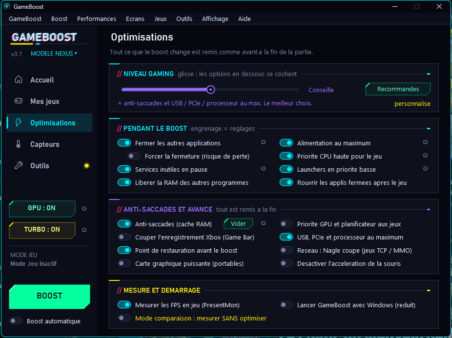
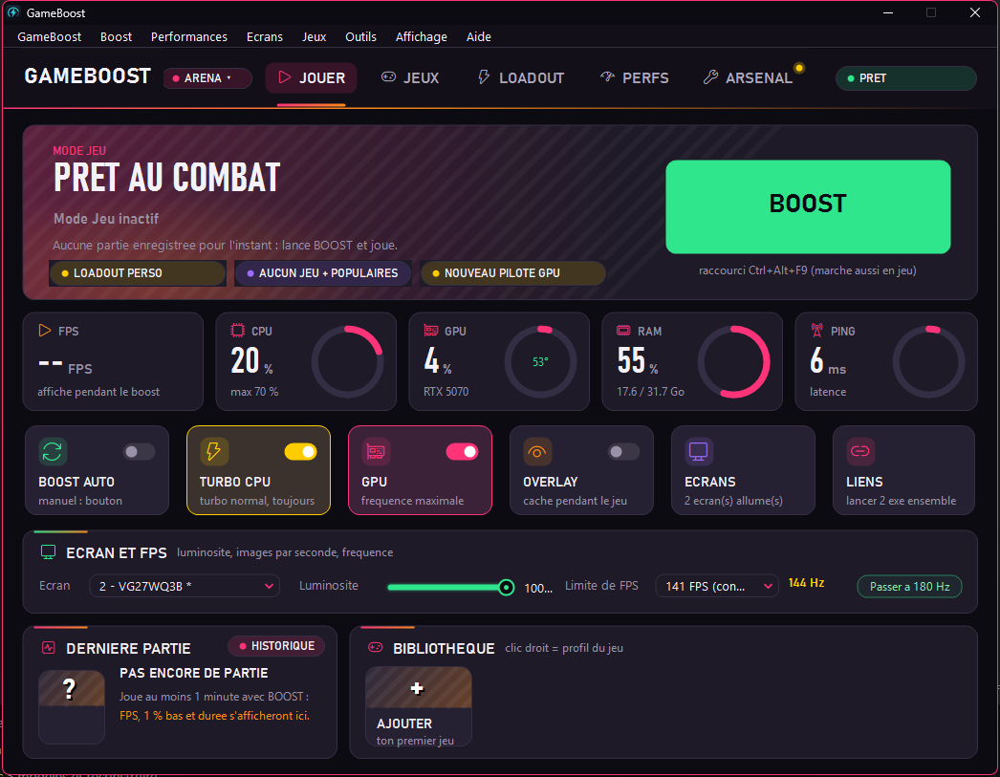
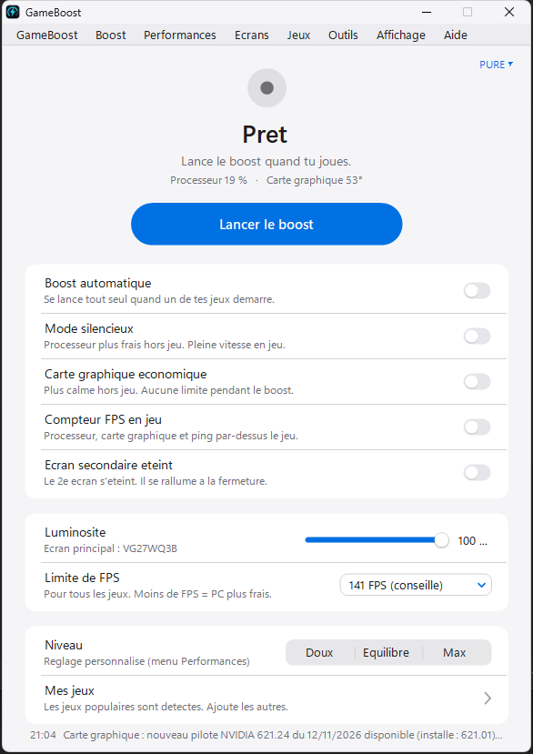
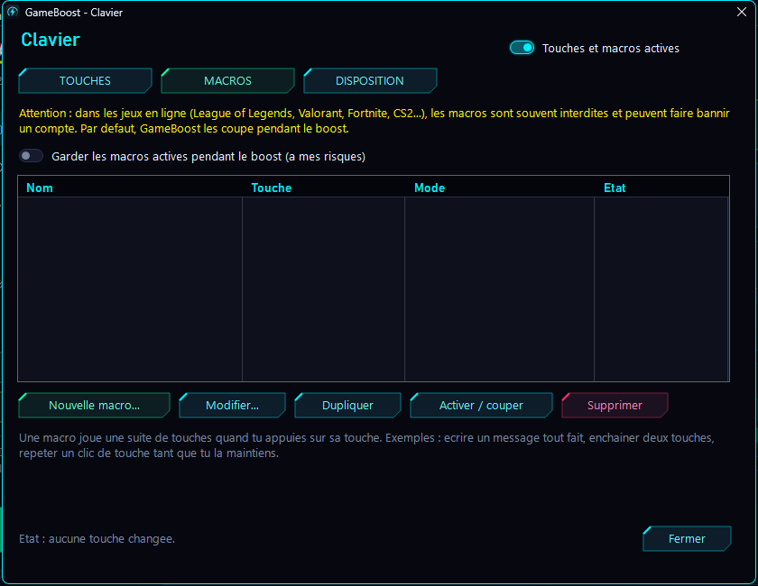
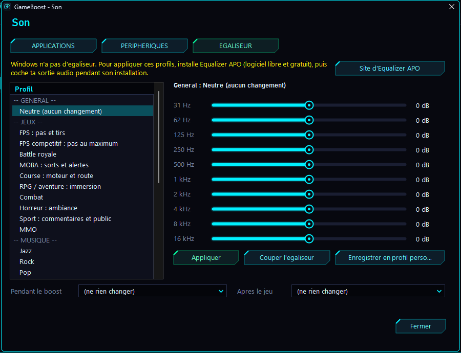

<p align="center"></p>

# GameBoost

Optimiseur de jeu pour Windows 10 et 11. Un bouton **BOOST** met le PC en mode jeu (applications en trop fermées, services inutiles en pause, alimentation au maximum), et tout est remis comme avant à la fin de la partie.

*Game optimizer for Windows 10 / 11. The interface is in French.*

| NEXUS | ARENA | PURE |
|---|---|---|
|  |  |  |

| Clavier : macros | Son : égaliseur |
|---|---|
|  |  |

## Ce que fait GameBoost

- **Boost en un clic** : ferme les autres applications, met en pause les services inutiles, passe l'alimentation au maximum, donne la priorité au jeu. Tout est rétabli quand le boost s'arrête.
- **Trois modèles dans le même programme** : NEXUS (complet), ARENA (gaming), PURE (simple). Le moteur et les réglages sont les mêmes.
- **Panneau rapide près de l'horloge** : boost, état du PC (CPU, GPU, RAM, températures), luminosité de chaque écran, éteindre un écran, limite de FPS.
- **Mesures** : images par seconde en jeu (avec [PresentMon](https://github.com/GameTechDev/PresentMon)), températures, historique des parties.
- **Écrans** : luminosité, fréquence, extinction d'un écran secondaire.
- **Recherche** (Ctrl+K) : écris ton besoin avec tes mots (« mon jeu rame », « pc trop chaud », « pas de son ») et GameBoost propose les bonnes options. Elle comprend les mots proches et les fautes de frappe.
- **Raccourcis clavier** personnalisables, y compris en jeu.
- **Clavier** : changer ou désactiver une touche, macros (une fois, répétée, bascule), passage AZERTY / QWERTY. Les macros sont coupées pendant le boost par défaut, car beaucoup de jeux en ligne les interdisent.
- **Son** : volume, sortie et micro de chaque application, périphériques par défaut, et un égaliseur avec 28 profils (jeux, musique, voix et films). L'égaliseur s'appuie sur [Equalizer APO](https://sourceforge.net/projects/equalizerapo/), à installer à part.
- **Outils** : pilotes, nettoyage, réglages de Windows, désinstallation complète d'un programme.
- **Retour en arrière** : une sauvegarde d'origine est faite au premier lancement, et le bouton **TOUT RESTAURER** remet Windows comme avant.

Le boost ne se lance jamais tout seul, sauf si tu actives le boost automatique.

## Installation

1. Télécharge `GameBoost-Setup.exe` depuis la page [Releases](../../releases).
2. Lance-le et clique sur **Installer**.

GameBoost s'installe dans `C:\Program Files\GameBoost`, avec un raccourci dans le menu Démarrer et une entrée dans *Paramètres > Applications* pour le désinstaller.

Version portable : `GameBoost.exe` se lance sans installation, depuis n'importe quel dossier.

### Droits administrateur

GameBoost règle des services, le plan d'alimentation et le registre : il a besoin des droits administrateur. L'installateur propose l'option *« Lancer GameBoost sans la question de Windows à chaque fois »*. Elle crée une tâche planifiée qui démarre GameBoost avec ces droits pour ton compte. Décoche-la si tu préfères confirmer à chaque lancement.

### Alerte de Windows ou de l'antivirus

Les fichiers ne sont pas signés numériquement. Windows peut afficher *« Windows a protégé votre ordinateur »* (clique sur *Informations complémentaires*, puis *Exécuter quand même*), et un antivirus peut signaler une fausse alerte. Tout le code est dans ce dépôt : tu peux le lire et reconstruire les fichiers toi-même.

## Construire depuis les sources

Rien à installer : le compilateur C# utilisé est celui fourni avec Windows.

```powershell
cd source
.\build.ps1
```

Les fichiers `GameBoost.exe` et `GameBoost-Setup.exe` sont créés dans `source\dist`.

Pour lancer le script directement, sans construire : `source\Lancer GameBoost.bat`.

## Organisation du code

| Dossier | Contenu |
|---|---|
| `source/GameBoost.ps1` | Toute l'application (PowerShell 5.1 + WinForms, avec des blocs C# compilés au premier lancement). |
| `source/launcher/` | `GameBoost.exe` : héberge le moteur PowerShell de Windows et exécute le script intégré. Aucun `powershell.exe` n'est lancé. |
| `source/installer/` | `GameBoost-Setup.exe` : installation, raccourcis, désinstallation. |
| `source/third_party/PresentMon/` | PresentMon (Intel, licence MIT), utilisé pour mesurer les images par seconde. |
| `tools/` | Petits tests à lancer une fois : écrans et carte graphique. |
| `LISEZ-MOI.txt` | Le mode d'emploi complet. |

Les textes de l'interface sont écrits sans accents dans le code.

## Sécurité

- Les fichiers extraits par `GameBoost.exe` vont dans `C:\ProgramData\GameBoost`, un dossier que seuls les administrateurs peuvent modifier.
- La tâche planifiée « sans question » ne lance que le `GameBoost.exe` installé dans `Program Files`.
- GameBoost n'a ni compte ni télémétrie. Il se connecte à Internet pour trois choses : chercher la dernière version des pilotes (sites NVIDIA, AMD, Intel et Windows Update), mesurer le ping, et installer une application avec winget quand tu le demandes.

## Avertissement

GameBoost modifie des réglages de Windows. Il est fourni tel quel, sans garantie (voir la licence). Le gain en jeu dépend du PC et de ce qui tournait en arrière-plan.

## Licence

[MIT](LICENSE). PresentMon est distribué sous sa propre licence MIT : `source/third_party/PresentMon/LICENSE.txt`.
